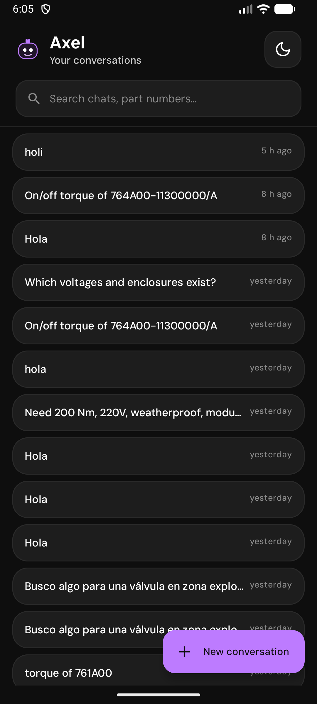
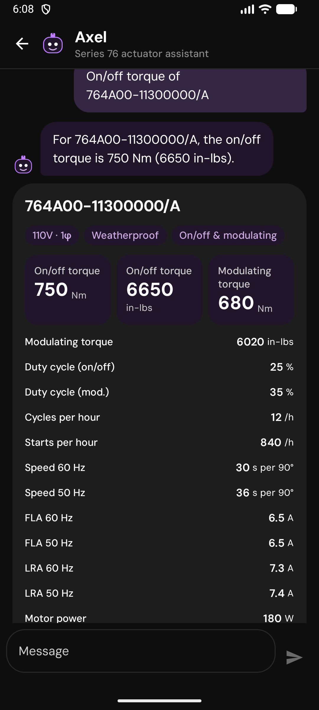
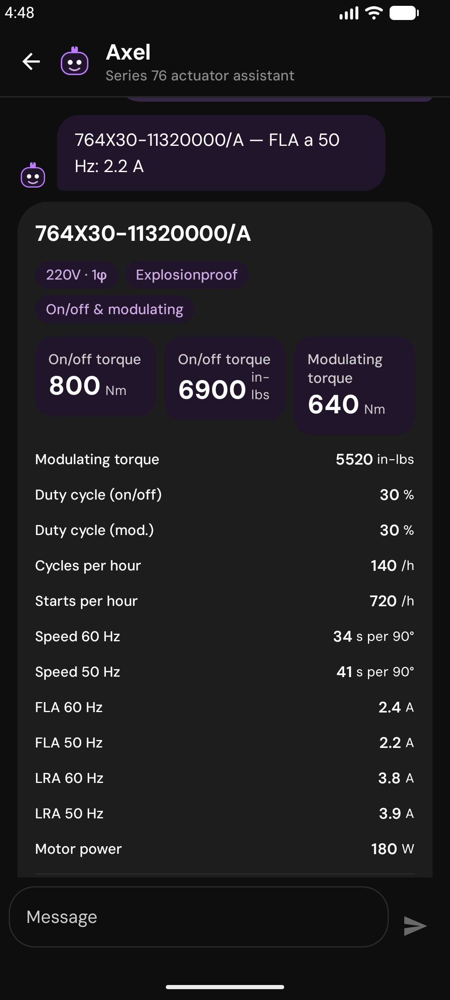
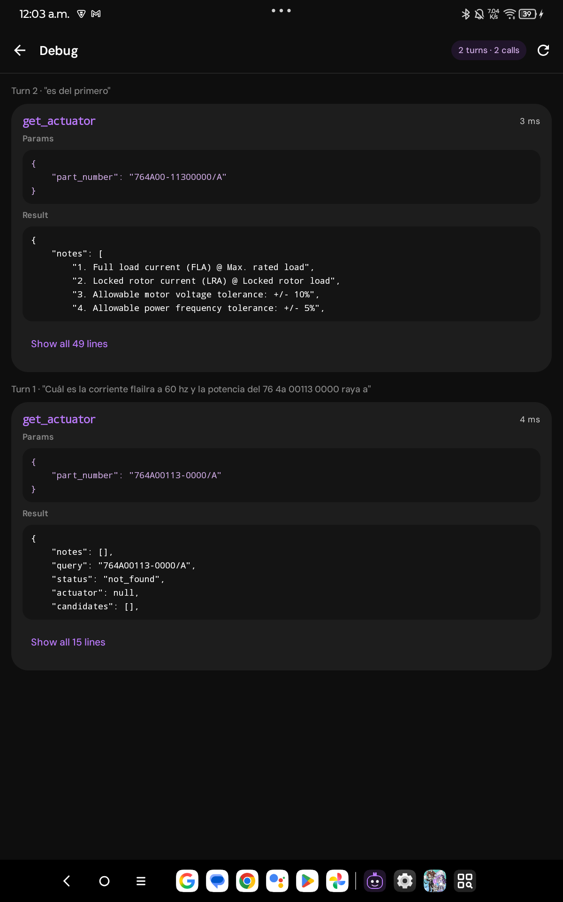
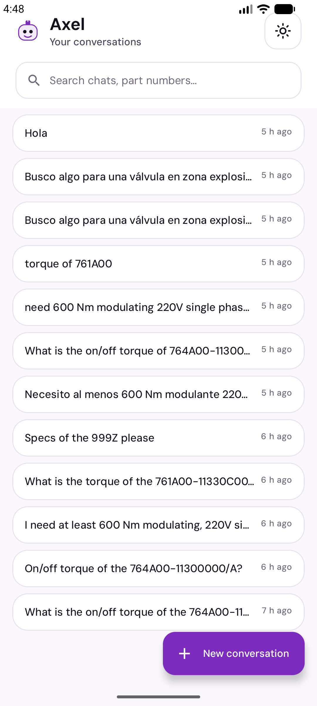

# Series 76 Technical Assistant

A technical assistant for plant engineers who select and look up **Series 76 electric actuators**. A FastAPI backend runs a LangChain agent over a PostgreSQL catalog extracted from an image-only PDF, and a native Android app (Kotlin + Jetpack Compose) is the client. **Every number the user sees comes from the database tables: the LLM only writes text, and product cards are built by code from tool results.**

| Conversations | Lookup | Comparison | Debug (hidden) | Light theme |
|---|---|---|---|---|
|  |  |  |  |  |

## 1. Quick start

Prerequisites: **Docker with Compose v2** (Docker Desktop or Colima) and an **OpenRouter API key**. Python/uv are only needed for local development (sections 2 and 3); Android Studio only for the app (section 4).

```bash
cp .env.example .env     # then edit .env: set LLM_API_KEY and AGENT_MODEL (see "Variables" below)
make up                  # build + start Postgres and the API, waits until healthy (up to 120 s)
export API_PORT=8000     # same value as API_PORT in your .env (default 8000)
curl -sf localhost:${API_PORT}/health
# Sign in with a seeded test user (section 8) and keep the token
TOKEN=$(curl -sf -X POST localhost:${API_PORT}/api/auth/login \
  -H 'Content-Type: application/json' \
  -d '{"email": "dev@konecto.test", "password": "dev-series76"}' | python3 -c 'import json,sys; print(json.load(sys.stdin)["token"])')
curl -sf -X POST localhost:${API_PORT}/api/conversation \
  -H 'Content-Type: application/json' -H "Authorization: Bearer $TOKEN" \
  -d '{"query": "What is the torque of 764X30-11320000/A?"}'
```

Expected: `/health` returns `{"status":"ok","actuators":68}`. The first start loads the 68 catalog rows from the committed `backend/data/processed/actuators.json` (no OCR, no key, no internet needed for the data).

**Variables to fill in `.env`** (never commit it; it is git-ignored):

| Variable | What to put |
|---|---|
| `LLM_API_KEY` | Your OpenRouter key. |
| `AGENT_MODEL` | An OpenRouter model id for the agent (see section 6). |
| `EXTRACT_LLM_MODEL` | Vision model used only if the PDF must be re-extracted (see section 3). Not needed for the quick start. |
| `LLM_BASE_URL` | Leave as is (OpenRouter). Any OpenAI-compatible endpoint works. |
| `API_PORT` | Host port of the API. **Default 8000.** If it is taken, set e.g. `API_PORT=8001` in `.env` (or prefix the command: `API_PORT=8001 make up`) and use that port in every URL below (the curl examples read `${API_PORT:-8000}`; export it in your shell or replace it by hand). |
| `DB_PORT` | Host port of Postgres. **Default 5432.** `DATABASE_URL` and `TEST_DATABASE_URL` in `.env.example` interpolate `${DB_PORT}`, and the tests read it from `.env`. |
| `API_BIND` / `DB_BIND` | Interfaces the API / Postgres ports bind to. **Default `127.0.0.1`.** `API_BIND=0.0.0.0` is only for a phone over Wi-Fi. |

Without a key the stack still starts; `POST /api/conversation` then answers `503 llm_not_configured`.

Response shape (abridged):

```json
{
  "session_id": "uuid",
  "answer": "text written by the LLM",
  "products": [{"part_number": "764X30-11320000/A", "enclosure": "explosionproof", "voltage": "220V",
                "phase": 1, "service": "on_off_and_modulating", "csa_certified": true, "has_data": true,
                "fields": {"onoff_torque_nm": 800, "onoff_torque_in_lbs": 6900, "...": "..."}, "notes": []}],
  "debug": [{"tool": "get_actuator", "params": {}, "result": {}}]
}
```

Other `make` targets: `make down` (stop, keep data), `make reset` (stop **and delete the Postgres volume**, all conversations are lost), `make logs`, `make db` (Postgres only), `make help`.

## 2. Backend

**API** (FastAPI; interactive docs at `/docs`):

| Endpoint | Purpose |
|---|---|
| `POST /api/auth/login` | Body `{email, password}` -> `{token, user: {email, role}}`. Wrong email or password: 401 `invalid_credentials` (same answer for both). No token needed. |
| `POST /api/auth/logout` | Revokes the presented token (204). |
| `GET /api/auth/me` | `{email, role}` of the token's user. |
| `POST /api/conversation` | Body `{session_id?, query}` -> `{session_id, answer, products, debug}`. No `session_id` creates a session; an unknown one returns 404 (D-09). The user message is saved before the agent runs, so a 503 never loses it. |
| `GET /api/sessions?q=&limit=` | Conversation list, newest first. With `q`, case-insensitive search over titles and messages; each hit has `match {where, snippet}` (D-37). |
| `GET /api/sessions/{id}/messages` | Full history including `products` and `trace` (per-message tool trace). |
| `GET /health` | `{"status":"ok","actuators":<row count>}`. Public. |

Every `/api` route except login needs `Authorization: Bearer <token>`; without a valid token it answers 401 `unauthorized`. Each user sees and uses only their own conversations: another user's `session_id` answers 404, like an unknown one. `debug` and `trace` hold the tool calls only for the `developer` role; for `user` they are empty lists (D-43).

Errors are `{error, detail}`: `llm_unavailable`, `llm_not_configured`, `database_unavailable` (all 503), `turn_in_progress` (409: the same conversation is still answering the previous message, D-46), `unauthorized` / `invalid_credentials` (401), 404, 422. Conversations live in the same Postgres volume and survive restarts.

**CLI** (no API needed; needs `make db` and a key; install [uv](https://docs.astral.sh/uv/), Python 3.12 is picked automatically):

```bash
make db
make chat                  # interactive multi-turn chat; "exit" to quit
make chat ARGS=--debug     # also prints the tool trace
make chat ARGS='-q "specs of 764A00-11300000/A"'
```

The CLI reads `DATABASE_URL` from `.env` (default `localhost:5432`, published by compose), runs the self-healing data check and never makes a paid vision call.

**Tests** (never call a real LLM; fake chat models only):

```bash
make db        # Postgres is needed for the integration tests; without it they are skipped
make test      # cd backend && uv run pytest -q
```

Tests use a separate `series76_test` database on the same container (`make db` and `make test` create it if missing, independent of any bind mount; `backend/docker/initdb/01-create-test-db.sh` also creates it on a fresh volume when the repo is on a path Docker shares; they never touch the app database). Tests that run real OCR are marked `slow` and skipped by default: `cd backend && uv run pytest -m slow`. With Colima, keep the repository under `$HOME`: Colima only mounts that tree into the VM, and a repo elsewhere gives empty bind mounts (the initdb script would not be seen).

**Agent evaluation** (calls the real LLM with your key; cost depends on `AGENT_MODEL`):

```bash
make db
make eval                                   # all 38 cases, writes backend/eval/report.md
cd backend && uv run python -m eval.run --only lookup-01,na-02 --workers 2   # a subset
```

`backend/eval/cases.yaml` has 49 cases in 10 categories: `lookup`, `recommend`, `invalid_pn`, `na`, `impossible`, `ambiguous`, `out_of_subset`, `multi_turn` (incl. follow-ups resolved in code, Sprint 8), `injection` (12 prompt-injection cases, Sprint 6), `small_talk` (greetings and thanks without re-introductions, Sprint 8). Checks are deterministic (tool called, tool status, part numbers in `products`, exact numbers in the answer, number guard not triggered). The exit code is 0 if the pass rate is >= 90% (`--min-pass`). `make eval` writes `backend/eval/report.md` (committed, it is the delivered report); use `--out` to write elsewhere. See D-29 for how it is run and what it costs.

## 3. Data and ingestion

Facts about `backend/data/raw/series_76_electric_data.pdf` (source of truth for all numbers; `series_76_summary.pdf` is business context only):

- 4 pages, **no text layer** (each page is an embedded image), so OCR or vision is required.
- 7 tables with 4 different column layouts, two-level headers, merged cells, thousands separators; **68 rows** in total.
- 4 rows are `N/A` (761A, 761B, 762A, 762B, three-phase): valid part numbers without data (`has_data=false`). Part numbers ending in `/A*` are not CSA certified (`csa_certified=false`).
- The PDF is a subset: no 24V weatherproof, no three-phase explosionproof. The agent says so instead of inferring.

**Self-healing cascade** (`ensure_data()`, runs at API start, in the CLI and in `ingest.py`):

1. Postgres has exactly as many rows as the JSON (68) and the JSON is valid: nothing to do. An exact count, not "not empty", detects partial loads (D-06).
2. Otherwise, if `actuators.json` exists and passes validation: idempotent upsert into Postgres.
3. Otherwise, extract from the PDF: RapidOCR (offline) on 2x crops, flag doubtful cells, escalate only the flagged tables to a vision model (`EXTRACT_LLM_MODEL`), validate, write the JSON, load.
4. If validation fails: abort with a clear message; nothing doubtful is loaded.

**Hybrid extractor (D-01).** RapidOCR scored 99.45% on the benchmark, vision per table 100%. The hybrid flags a cell when OCR confidence is below 0.9, the raw text has a leading zero, or a validator fails, and sends those whole tables to vision. Validations: row count per table, numeric parsing, in-lbs/Nm ratio about 8.85 (5%), FLA <= LRA, 60 Hz speed <= 50 Hz (warning), duty 0-100, part-number regex. Values are stored as printed (no conversion, no "fixing"). The committed JSON is the verified result, so the normal path needs no key. `actuators.json` is never overwritten without `--force`.

```bash
make ingest                                  # runs ensure_data (no-op when 68 rows are loaded)
make ingest ARGS=--reset                     # empty the tables, then reload
make ingest ARGS="--from-pdf --force --no-escalation"   # offline OCR run (see below)
make ingest-pdf                              # full rebuild inside Docker, with vision escalation
```

Flags of `ingest.py`: `--reset`, `--from-pdf` (re-extract even if the JSON exists), `--force` (allow overwriting the JSON), `--no-escalation` (never call a model), `--json PATH`.

- **Offline OCR run** (`--from-pdf --force --no-escalation`): RapidOCR only, no model call. If OCR flags any cell (low confidence, leading zero, or a failed validation), the run refuses to load doubtful data. It aborts with a message listing the flagged cells, and it writes neither the JSON nor the database. So this path does not rebuild the JSON when OCR is not clean.
- **Full rebuild** (`make ingest-pdf`, runs inside Docker): flagged tables are re-read by the vision model in `EXTRACT_LLM_MODEL` (at most `VISION_MAX_CALLS` calls). It needs `LLM_API_KEY` and `EXTRACT_LLM_MODEL` in `.env`, and it calls the paid model. The new JSON is written to `backend/data/rebuilt/actuators.json` (gitignored), never over the committed file; compare it before copying it. Verified on 2026-11-06 (Sprint 8): offline OCR reads all 68 rows at 99.75% cell accuracy and flags 8 cells in 4 tables; vision (`anthropic/claude-sonnet-5.5`) re-read those 4 tables in 4 calls for about USD 0.12 (about USD 0.03 per call; OpenRouter books costs late, see the notes in `docs/spend-log.md`), and the output was byte-identical to the committed `actuators.json` (0 cells differ from the golden file). Costs are logged in `docs/spend-log.md`.
- At startup the API only re-extracts when both the JSON and the database are unusable. With `STARTUP_ESCALATION=auto` (default) it escalates flagged tables to vision only if `LLM_API_KEY` and `EXTRACT_LLM_MODEL` are set; `off` never calls a model, `on` always may. A normal start with the committed JSON never spends.

**Recovery test** against the real compose stack (DB deleted, JSON deleted, rows deleted, JSON corrupted, restart keeps conversations):

```bash
make recovery                 # destructive scenario (a) is SKIPPED
make recovery ARGS=--yes      # WARNING: also runs `docker compose down -v` (deletes the Postgres volume and all conversations)
API_PORT=8001 make recovery   # if you use another port
```

## 4. Android app (`mobile/android`)

Kotlin + Jetpack Compose (Material 3), MVVM, Retrofit. `minSdk 26`, JVM target 17. Contract: `mobile/android/CONTRACT.md`; design: `mobile/android/DESIGN.md` (mockups in `docs/design/`).

Requirements: Android Studio (with an SDK and an emulator, or a USB phone with USB debugging) and `adb` on your PATH (`$ANDROID_HOME/platform-tools`).

1. Start the backend (section 1).
2. Create `mobile/android/local.properties` (git-ignored; Android Studio creates it with `sdk.dir`) and add the API URL **using your `API_PORT`**:
   ```properties
   sdk.dir=/path/to/Android/sdk
   # replace 8000 with your API_PORT
   api.baseUrl=http://localhost:8000/
   ```
   If the line is omitted the default is `http://localhost:8000/` (port 8000).
3. Make `localhost` on the device reach your computer (`adb reverse`, D-35). Repeat after every emulator boot or USB reconnect:
   ```bash
   make android-reverse                      # uses API_PORT; works with exactly ONE device attached
   # with several devices (list them with `adb devices`; replace 8000 with your API_PORT):
   adb -s <serial> reverse tcp:8000 tcp:8000
   ```
4. Build and install, using the JDK bundled with Android Studio (macOS path shown):
   ```bash
   export JAVA_HOME="/Applications/Android Studio.app/Contents/jbr/Contents/Home"
   cd mobile/android
   ./gradlew installDebug          # installs on the connected emulator/phone
   ```
   Or open `mobile/android` in Android Studio and press Run. Launch "Series 76" on the device.

**Release build:** `./gradlew installRelease` builds an R8-optimized APK signed with the debug key, for local testing only (not a distributable release). Debug builds are noticeably less smooth, so use the release build to judge animations.

A physical phone over USB works the same way (`adb reverse`). Over Wi-Fi instead: set `API_BIND=0.0.0.0` in `.env`, `api.baseUrl` to the computer's LAN IP, and note the app only allows cleartext HTTP to `localhost` and `10.0.2.2` (`res/xml/network_security_config.xml`), so that path also needs a config change. The API requires a login (D-43), but it has no rate limiting and every user shares one OpenRouter key: do not expose it on an untrusted network.

Tests:

```bash
cd mobile/android
./gradlew testDebugUnitTest          # JVM unit tests, no device needed
./gradlew connectedDebugAndroidTest  # needs a device; UNINSTALLS the app when it finishes (reinstall with installDebug)
```

Usage: Conversations screen (list, new conversation, **search** by title or message text, theme menu Dark/Light/System), Chat (product cards and a comparison table when several products match), and a **hidden Debug screen** (developer role only, see below) to see the tool calls (parameters and raw results) of each turn. The chat itself never shows tool names or traces.

**Sign in.** Without a stored session the app opens on the Login screen; with one, it opens on Conversations. Enter the email and password of a test user (section 8). The password field has a show/hide toggle, and wrong credentials or network errors appear under the form. The token is kept in the app's `auth` DataStore and sent as `Authorization: Bearer` on every request. If the server answers 401 at any other time (for example, an expired token), the app clears the session and returns to Login with the back stack cleared. To sign out, open the Account menu (person icon) in the conversations header. The app calls `POST /api/auth/logout` on a best-effort basis and always clears the local session.

**Voice conversation.** Tap the microphone button in the chat input and speak: partial results appear in the text field while you talk. The app asks for the microphone permission (`RECORD_AUDIO`) the first time you use it. If you deny it, the app explains why and typing keeps working; if you denied it permanently, the app tells you to enable it in the device Settings. If the device has no speech recognizer, the app says voice is unavailable. When a message was spoken, the app reads the answer aloud with the device text-to-speech. Only the answer text is read: product cards and tables are not. Every assistant message also has a speaker button to read it aloud or stop it. Spanish or English is picked from the text (a simple heuristic in `voice/SpeechLanguage.kt`), and numbers and part numbers are read exactly as printed. Everything runs on the device: the backend does not change and there is no OpenRouter cost. Recognition works offline when the device has the offline language pack for the language; otherwise the recognizer may need the network.

**Debug screen (developer role + 5 taps on the title).** Tap the chat title (Axel) five times to open the Debug screen, which shows the tool calls and raw results of each turn. The gesture works only when the signed-in user has the `developer` role (`dev@konecto.test`, section 8). For a `user` account it does nothing, and the server sends no trace in any case (D-43).

**Accessibility.** Controls have content descriptions, touch targets are at least 48 dp, and headings and live regions are exposed to TalkBack (Sprint 8, wave 4).

## 5. Design and trade-offs

Full list with alternatives in [`docs/DECISIONS.md`](docs/DECISIONS.md) (D-01 to D-50); architecture in [`docs/ARCHITECTURE.md`](docs/ARCHITECTURE.md).

- **Typed columns, not a JSON blob (D-04, D-05).** Filtering by torque, voltage, phase, enclosure, service and duty is plain SQL. No ORM, plain `psycopg` (D-03).
- **The LLM never writes SQL.** Three parameterized tools: `get_actuator` (found / found without data / not found with suggestions / ambiguous candidates), `search_actuators` (filters, tightest match first, says which constraint blocked an empty result), `describe_catalog` (for ambiguous questions). Torque and duty must be met in the same operating mode (D-22).
- **Numbers come from the tables.** Product cards are built by code from tool results. A **number guard** checks that every figure in the answer, including numbers written as words, appears in the tool results; a figure written next to a part number must belong to that product, and a follow-up about the only product shown before is bound to it (D-44, D-47). There are no always-allowed numbers: only list ordinals, the 90° stroke and counts of what a tool returned pass without a value. If a figure is not verified, a deterministic template answer replaces it and the trace records it. Known limits: binding is per product, not per field, and earlier user turns are trusted (D-40).
- **Own history in Postgres, plain `create_agent` (D-07, D-08).** No LangGraph graph, no checkpointer. Follow-ups re-call the tools; the model does not remember figures (D-27). Only the last `HISTORY_TURNS` messages (default 10) are sent to the model; the product context still comes from the whole history (D-45).
- **No pgvector.** Queries are numeric filters, not semantic search.
- **Login with bearer tokens (D-43).** Passwords are argon2id hashes and tokens are stored as SHA-256 hashes. Each user sees only their own conversations, and the tool trace is returned only to the `developer` role. There is no rate limiting. Both ports bind to `127.0.0.1` by default (D-34); the container runs as a non-root user.
- **`adb reverse` instead of `10.0.2.2` (D-35)**, because Colima's port forwarding never delivered emulator traffic.
- **Conversation search with `ILIKE` (D-37)**, correct for part numbers and numbers; a sequential scan is fine for a single-user history.
- **Persona "Axel" (D-39).** Prompt rule plus a code check that rewrites the underlying model's own name to "Axel"; generic tool errors (no DB text reaches the model or client).
- **Hybrid extractor (D-01).** Offline by default, paid vision only for flagged tables. **Known limitation:** the flag rule was tuned on this PDF only, because the brief asks for this PDF. On another catalog, doubtful cells would still escalate to vision and validation would abort on mismatches, but the rule has not been tested on other PDFs.
- **Edge cases handled:** invalid or partial part numbers, N/A rows, ambiguous requests, requirements no model meets (closest value is reported), data outside the PDF subset, multilingual questions (answers follow the user's language, numbers stay as printed).

## 6. Models per task

Models are configured only by environment variables (`get_llm(task)` in `backend/app/llm.py`), through OpenRouter or any OpenAI-compatible endpoint.

| Task | Variable | Choice and reason |
|---|---|---|
| Chat agent (tool calling and short answers in the user's language) | `AGENT_MODEL` | Development: `stealth/crouton-alpha` (free on OpenRouter, USD 0 in all runs; 26/26 on the original 26-case set, 38/38 with the injection cases). Recommended: `openai/gpt-6-luna`; results below. |
| PDF extraction, vision escalation of flagged tables | `EXTRACT_LLM_MODEL` | A vision-capable model; the design reference is Claude Sonnet (100% cell accuracy per table in the benchmark, D-01). Only used when the PDF is re-extracted with escalation on. Real run: 4 calls, about USD 0.12, output identical to the committed JSON (D-49). |

**Final evaluation (`openai/gpt-6-luna`, Sprint 8): 48/49 cases (98%), USD 0.008 for the whole run, with the stricter number guard (D-44) and the new small-talk, follow-up, comparison and long-session cases.** The one failure (`subset-02`) gives the right answer (the catalog has no three-phase explosionproof actuator, with the real alternatives) but reaches it through `describe_catalog` instead of the expected `search_actuators`. Report: [`backend/eval/report.md`](backend/eval/report.md). The Sprint 7 run on the previous 38 cases scored 38/38; the benchmark table below is from that run.

Why this model (D-42): six tool-capable models were benchmarked on the same 38 cases (one benchmark run each; costs vary a little between runs).

| Model | Passed | Time | Cost per run |
|---|---|---|---|
| `openai/gpt-6-luna` | 38/38 | 71 s | USD 0.011 |
| `deepseek/deepseek-v4.1-flash` | 36/38 | 48 s | USD 0.017 |
| `anthropic/claude-haiku-5.5` | 34/38 | 75 s | USD 0.024 |
| `google/gemini-2.5-flash-lite` | 34/38 | 33 s | USD 0.002 |
| `z-ai/glm-5.3-flash` | 30/38 | 246 s | USD 0.029 |
| `qwen/qwen3.8-flash` | 27/38 | 413 s | USD 0.037 |

Development used the free `stealth/crouton-alpha` (38/38), which can disappear or start charging at any time.

Note: free "stealth" models are temporary and can disappear or be rate limited; if `AGENT_MODEL` stops working, set another OpenRouter id in `.env` and restart (`docker compose up -d`).

## 7. Security

Two runs of Cloudflare's `security-audit` skill (vendored in `.claude/skills/security-audit`) plus 12 prompt-injection eval cases: **0 confirmed vulnerabilities, 3 documented leads**, all about the unauthenticated, localhost-only API (paid-LLM spend with no rate limit, unbounded history resent to the model, number-guard trust of shared-session turns, D-40). They only matter if the API is exposed beyond `127.0.0.1`. Details: [`docs/security/REPORT.md`](docs/security/REPORT.md).

## 8. Optionals

Both optional features are implemented: login (D-43, backend and Android app) and voice conversation (D-48, Android app).

**Login (implemented, D-43).** Email and password return an opaque token, valid for 7 days, sent as `Authorization: Bearer <token>`. Passwords are stored as argon2id hashes and tokens as SHA-256 hashes, so neither can be read back from the database. Each user sees only their own conversations. The OpenRouter key stays on the server and is shared by all users. Test users, created at startup (`SEED_TEST_USERS=off` disables them):

| Email | Password | Role |
|---|---|---|
| `ana@konecto.test` | `ana-series76` | user |
| `ben@konecto.test` | `ben-series76` | user |
| `dev@konecto.test` | `dev-series76` | developer (also receives the tool trace for the Debug screen) |

Conversations created before login existed (no owner) are not shown to anyone.

**Voice conversation (implemented, D-48):** on-device speech-to-text and text-to-speech in the Android app, described in section 4. No backend change.

## 9. Repo layout and AI configuration

```
backend/
  app/{domain,ingestion,db,agent,api}/  bootstrap.py  llm.py
  cli.py  ingest.py  Dockerfile  pyproject.toml  uv.lock
  data/{raw/series_76_electric_data.pdf, processed/actuators.json}
  eval/  tests/  docker/initdb/
mobile/android/      Compose app, CONTRACT.md, DESIGN.md
docs/                ARCHITECTURE.md  DECISIONS.md  TOOLING.md  security/  design/  screenshots/
docker-compose.yml  Makefile  .env.example
.claude/  .mcp.json  skills-lock.json   AI configuration (committed)
```

The AI configuration is committed: `.claude/` (settings and skills: LangChain skills, `supabase-postgres-best-practices`, `android-development`, `security-audit`, `swarm`), `.mcp.json` (mobile, LangChain docs) and `skills-lock.json`; `CLAUDE.md` holds the project brief and working rules. Sources, versions and the review of each tool are in [`docs/TOOLING.md`](docs/TOOLING.md). No secrets are stored in any of them.

## 10. Troubleshooting

- **Port already in use** (`bind: address already in use`): set `API_PORT` (and/or `DB_PORT`, then update `DATABASE_URL` and `TEST_DATABASE_URL` in `.env`) to a free port, then `make up`. Update `api.baseUrl` and `adb reverse` to match.
- **`Cannot connect to the Docker daemon`**: start Docker Desktop, or Colima (`colima start`).
- **`make up` times out**: `make logs`. A first start downloads images and builds a large image (about 1.4 GB, D-33).
- **Emulator or phone cannot reach the API** (app shows the offline banner): run `make android-reverse` (or `adb -s <serial> reverse ...`) again, check that `api.baseUrl` uses the same port as `API_PORT`, and that `curl localhost:<port>/health` works on the computer. Rebuild the app after editing `local.properties`.
- **`adb reverse` fails with "more than one device"**: use `adb -s <serial> reverse tcp:<port> tcp:<port>`.
- **503 `llm_not_configured`**: `LLM_API_KEY` or `AGENT_MODEL` is empty in `.env`; after editing, run `docker compose up -d` to recreate the API container.
- **503 `llm_unavailable`**: wrong or exhausted key, unknown model id, or provider rate limit; see `make logs` for the cause. The user message is already saved; retry with the same `session_id`.
- **Free models answering 429 or timing out**: wait and retry, lower `--workers` in the eval, or set a different `AGENT_MODEL`.
- **Tests skipped with "Postgres unreachable"**: run `make db`. "Test database missing": `make db` (it creates `series76_test` if needed; no data is lost).
- **Start from scratch**: `make reset && make up` (deletes all conversations).
